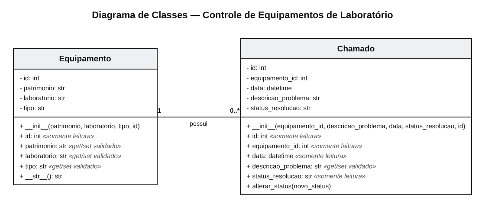
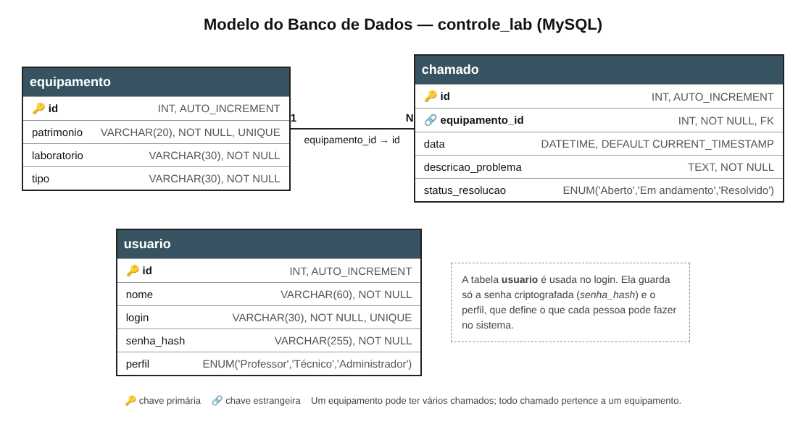
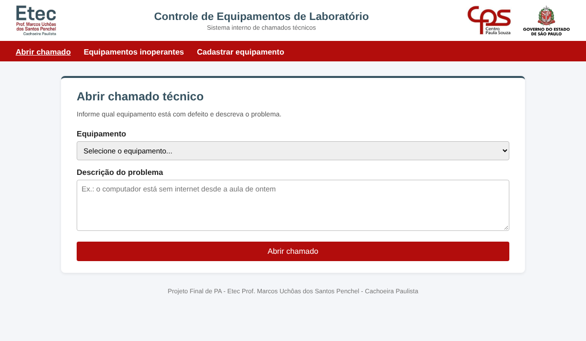
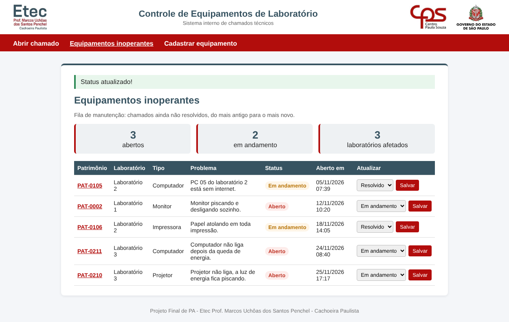
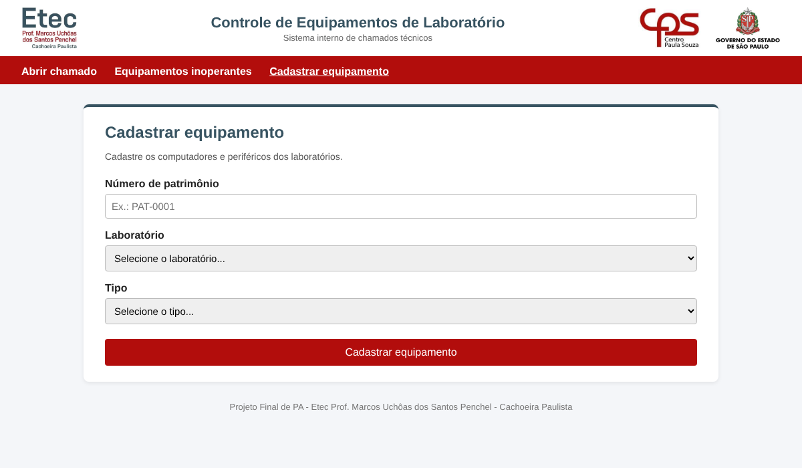
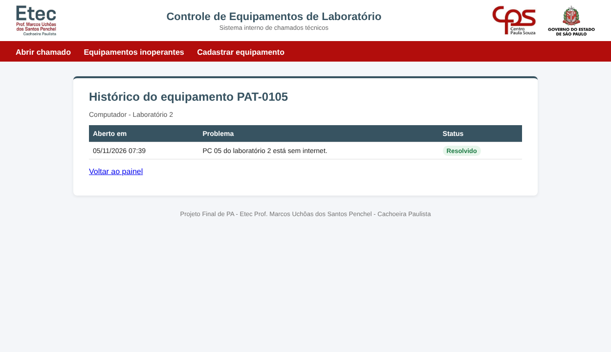

# Controle de Equipamentos de Laboratório - ETEC

Sistema web interno para a Etec Prof. Marcos Uchôas dos Santos Penchel (Cachoeira Paulista) registrar chamados de defeito em computadores e periféricos dos laboratórios e organizar a fila de manutenção.

## Sobre o projeto

Hoje, quando um equipamento do laboratório apresenta defeito, o aluno avisa o professor, o professor avisa o técnico de manutenção e o técnico anota em papel. Esse registro se perde com facilidade, e a máquina fica parada por dias ou semanas.

O sistema resolve esse problema: o professor abre um **chamado técnico** informando a máquina e o problema, e o técnico passa a ter um **painel** com todos os equipamentos inoperantes, do chamado mais antigo para o mais novo. Todo o histórico fica guardado em um banco de dados MySQL.

### Objetivo

Desenvolver um sistema web interno para a Etec que permita ao professor abrir chamados técnicos informando o equipamento com defeito e o problema, e ao técnico de manutenção visualizar os equipamentos inoperantes e acompanhar a fila de manutenção, substituindo as anotações em papel e mantendo o histórico no banco de dados MySQL.

### Usuários

| Usuário | O que faz no sistema |
|---------|----------------------|
| Professor | Abre o chamado escolhendo a máquina e descrevendo o problema |
| Técnico de Manutenção | Vê o painel de inoperantes, muda o status e consulta o histórico |
| Administrador | Cadastra os equipamentos dos laboratórios |

## Integrantes

| Integrante | Função |
|------------|--------|
| Vitor Barbosa | Tech Lead - front-end (HTML/CSS) e Flask |
| Lucas | Back-end - Python e MySQL |
| Pedro | Documentação |
| Rodrigo | Usuários, cronograma, dados e testes |

## Funcionalidades

- [x] Abertura de chamado, gravado no banco de dados
- [x] Painel de equipamentos inoperantes com os dados reais do banco
- [x] Alteração do status do chamado pelo painel
- [x] Cadastro de equipamentos
- [x] Histórico de chamados por equipamento
- [x] Classes com encapsulamento (Equipamento e Chamado)
- [x] Banco de dados MySQL com dados de teste
- [x] Validação dos dados com mensagens de erro claras

Os requisitos completos estão em [docs/requisitos.md](docs/requisitos.md) e o passo a passo de uso está no [Manual do Usuário](docs/manual_usuario.md).

## Tecnologias

| Tecnologia | Uso no projeto |
|------------|----------------|
| Python 3 | Linguagem principal do sistema |
| Flask | Servidor web e páginas do sistema |
| MySQL | Banco de dados dos equipamentos e chamados |
| MySQL Workbench | Criação e visualização do banco |
| mysql-connector-python | Conexão do Python com o MySQL |
| HTML, CSS e Jinja | Estrutura, aparência e modelos das páginas |
| Git e GitHub | Versionamento e colaboração |
| Trello | Gestão das tarefas |

## Estrutura do projeto

```
projeto-final/
|-- app.py                 -> servidor Flask e rotas
|-- models.py              -> classes Equipamento e Chamado
|-- conexao.py             -> conexão com o MySQL
|-- repositorio.py         -> funções que leem e gravam no banco
|-- teste_models.py        -> testes das classes
|-- teste_repositorio.py   -> testes do repositório
|-- teste_status.py        -> testes de status e histórico
|-- templates/             -> páginas HTML (Jinja)
|-- static/                -> CSS e logos
|-- sql/
|   |-- banco.sql          -> criação do banco e das tabelas
|   `-- dados_teste.sql    -> equipamentos e chamados de teste
`-- docs/                  -> requisitos, diagramas e imagens
```

## Modelagem

### Diagrama de classes



### Banco de dados



O banco `controle_lab` tem duas tabelas ligadas por chave estrangeira: um equipamento pode ter vários chamados, e todo chamado pertence a um equipamento. O próprio banco impede patrimônio repetido, chamado de equipamento inexistente e status diferente de **Aberto**, **Em andamento** ou **Resolvido**.

## Encapsulamento

As classes `Equipamento` e `Chamado` protegem os dados contra alterações acidentais:

| Classe | Atributo / método | Proteção |
|--------|-------------------|----------|
| Equipamento | `id` | Privado e somente leitura |
| Equipamento | `patrimonio`, `laboratorio` | Não podem ficar vazios |
| Equipamento | `tipo` | Aceita apenas os tipos válidos |
| Chamado | `id`, `equipamento_id`, `data` | Privados e somente leitura |
| Chamado | `descricao_problema` | Mínimo de 10 caracteres |
| Chamado | `status_resolucao` | Só muda pelo método `alterar_status()` |
| Chamado | `alterar_status()` | Aceita só status válidos e bloqueia chamados já resolvidos |

## Como executar

1. Instale o **Python 3** e o **MySQL Server** (com o MySQL Workbench).
2. No MySQL Workbench, execute `sql/banco.sql` e depois `sql/dados_teste.sql`.
3. Instale as bibliotecas:
   ```
   pip install flask mysql-connector-python
   ```
4. Em `conexao.py`, coloque a senha do seu usuário root do MySQL.
5. Teste as classes e a conexão:
   ```
   python teste_models.py
   python teste_repositorio.py
   python teste_status.py
   ```
6. Inicie o sistema:
   ```
   python app.py
   ```
7. Abra **http://127.0.0.1:5000** no navegador.

## Telas

### Abertura de chamado


### Painel de equipamentos inoperantes


### Cadastro de equipamento


### Histórico do equipamento


## Testes

Os testes do sistema estão em [docs/testes.md](docs/testes.md) e na planilha [docs/planilha_equipamentos_e_testes.xlsx](docs/planilha_equipamentos_e_testes.xlsx): 11 testes executados e 11 aprovados.

## Andamento

| Entrega | Conteúdo | Situação |
|---------|----------|----------|
| 1 | Planejamento, requisitos, banco de dados, classes e telas em HTML | Concluída |
| 2 | Flask, conexão com o banco, cadastro de equipamentos, README e diagramas | Concluída |
| 3 | Integração: formulário gravando no banco, painel com dados reais, status, histórico e manual | Concluída |
| 4 | Testes, correções, documentação final e ensaios da apresentação | Em andamento |

## Links

- Quadro do Trello: https://trello.com/b/rLoEL3xl/projeto-final
- Pasta do OneDrive: (em construção)
