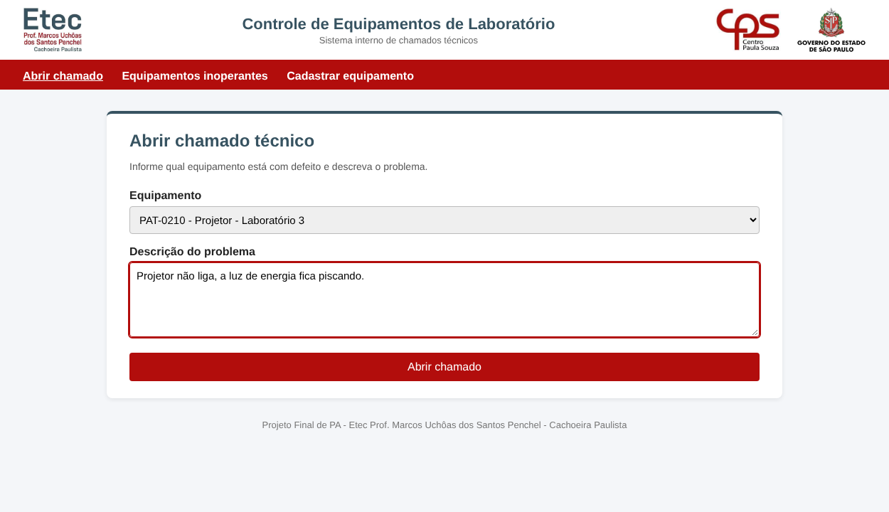
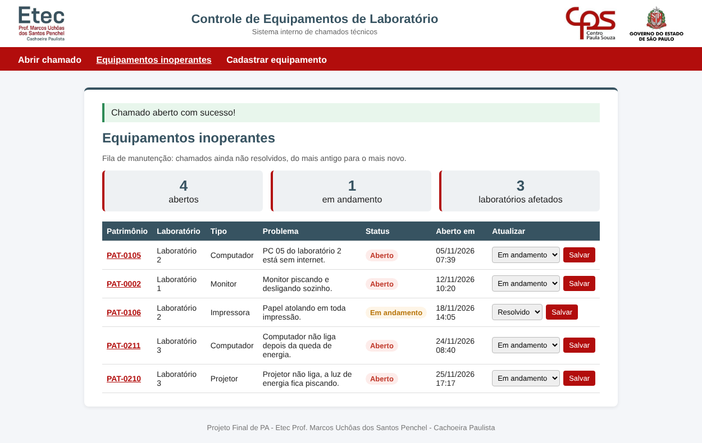
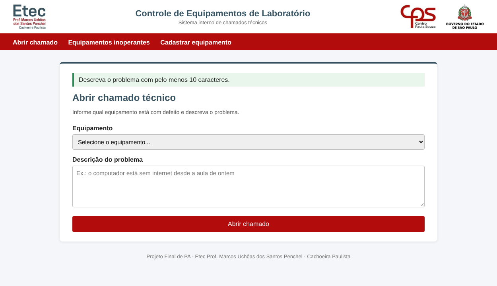
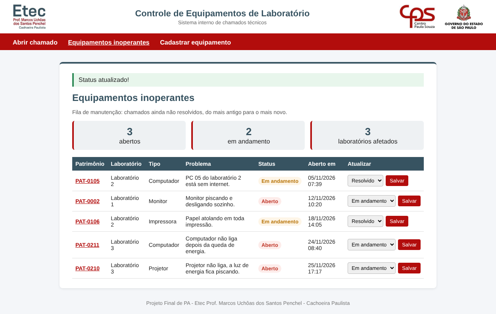
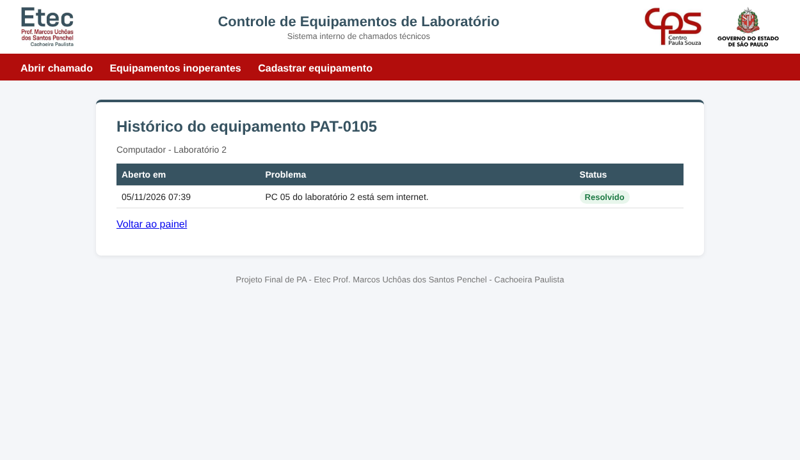
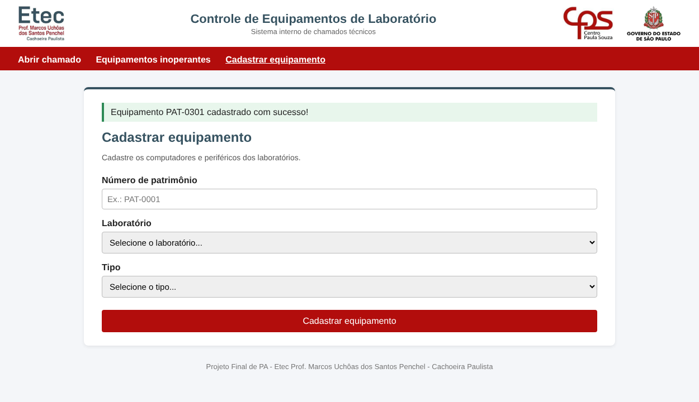
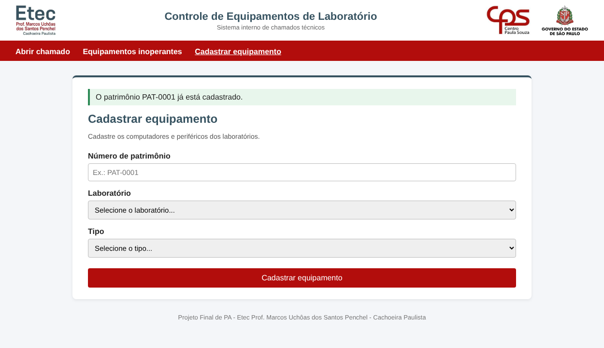

# Manual do Usuário - Controle de Equipamentos de Laboratório

Este manual explica como usar o sistema de chamados técnicos dos laboratórios da Etec Prof. Marcos Uchôas dos Santos Penchel.

O sistema tem três telas, acessadas pelo menu vermelho no topo:

| Tela | Quem usa | Para que serve |
|------|----------|----------------|
| Abrir chamado | Professor | Avisar que um equipamento está com defeito |
| Equipamentos inoperantes | Técnico de manutenção | Ver a fila de manutenção e atualizar o status dos chamados |
| Cadastrar equipamento | Administrador | Incluir novos computadores e periféricos |

---

## 1. Como abrir um chamado (professor)

1. Clique em **Abrir chamado** no menu.
2. Em **Equipamento**, escolha a máquina com defeito. Cada opção mostra o patrimônio, o tipo e o laboratório.
3. Em **Descrição do problema**, explique o que está acontecendo.
4. Clique em **Abrir chamado**.

O sistema grava o chamado com a data e a hora atuais e o status **Aberto**, e mostra o painel de inoperantes com a mensagem **"Chamado aberto com sucesso!"**. O novo chamado aparece no fim da fila.

**Atenção:** a descrição precisa ter pelo menos 10 caracteres. Se for muito curta, o chamado não é aberto e o sistema mostra um aviso.

---

## 2. Como atender um chamado (técnico de manutenção)

1. Clique em **Equipamentos inoperantes** no menu.
2. O painel mostra todos os chamados ainda não resolvidos, do mais antigo para o mais novo. No topo, há um resumo com a quantidade de chamados abertos, em andamento e de laboratórios afetados.
3. Na coluna **Atualizar**, escolha o novo status do chamado e clique em **Salvar**:
   - **Em andamento:** o técnico começou o conserto.
   - **Resolvido:** o equipamento voltou a funcionar. O chamado sai do painel.

**Regras do status:**
- Um chamado sempre começa como **Aberto**.
- Depois de **Resolvido**, o chamado não pode mais ser alterado.

---

## 3. Como ver o histórico de um equipamento

No painel, clique no **número de patrimônio** de qualquer equipamento. O sistema mostra todos os chamados que aquela máquina já teve, inclusive os resolvidos, do mais recente para o mais antigo.

Para voltar, clique em **Voltar ao painel**.

---

## 4. Como cadastrar um equipamento (administrador)

1. Clique em **Cadastrar equipamento** no menu.
2. Preencha o **Número de patrimônio** (por exemplo, PAT-0301).
3. Escolha o **Laboratório** e o **Tipo** do equipamento.
4. Clique em **Cadastrar equipamento**.

O sistema mostra a mensagem de confirmação, e o equipamento passa a aparecer na lista da tela **Abrir chamado**.

**Atenção:** cada patrimônio só pode ser cadastrado uma vez. Se o número já existir, o sistema avisa e não cadastra de novo.

---

## Mensagens do sistema

| Mensagem | O que significa |
|----------|-----------------|
| Chamado aberto com sucesso! | O chamado foi gravado e já está no painel |
| Descreva o problema com pelo menos 10 caracteres. | A descrição está muito curta |
| Status atualizado! | O status do chamado foi alterado |
| Chamado já resolvido não pode ser alterado. | O chamado já foi encerrado |
| Equipamento PAT-XXXX cadastrado com sucesso! | O equipamento foi incluído |
| O patrimônio PAT-XXXX já está cadastrado. | Esse número de patrimônio já existe |
| Equipamento não encontrado. | O histórico pedido é de um equipamento que não existe |
